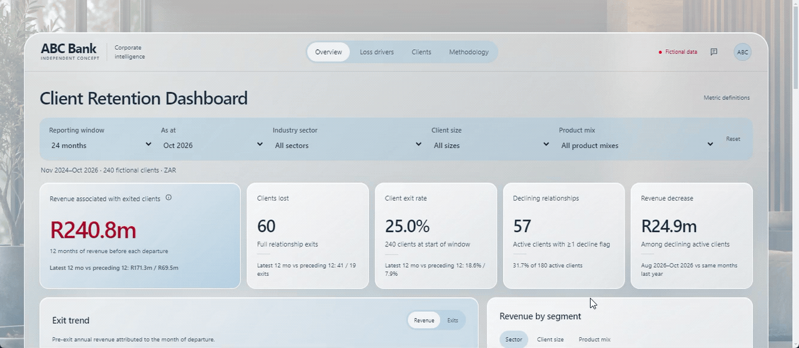

# Client Retention Dashboard

An interactive corporate banking concept for exploring client exits and declining relationships.

## Demo

[Open the interactive dashboard](https://corporate-retention-demo-aj.sturdyladle.chatgpt.site/)

## Explore

- Compare client exits and revenue across reporting periods.
- Explore segments by industry, client size, and product mix.
- Filter the client explorer, inspect client details, and export results.

## About the demo

ABC Bank is a fictional institution. The clients, measurements, and exit reasons are fictional, and no banking systems are connected. The data is a fixed demonstration snapshot. Review notes are stored in the current browser.
